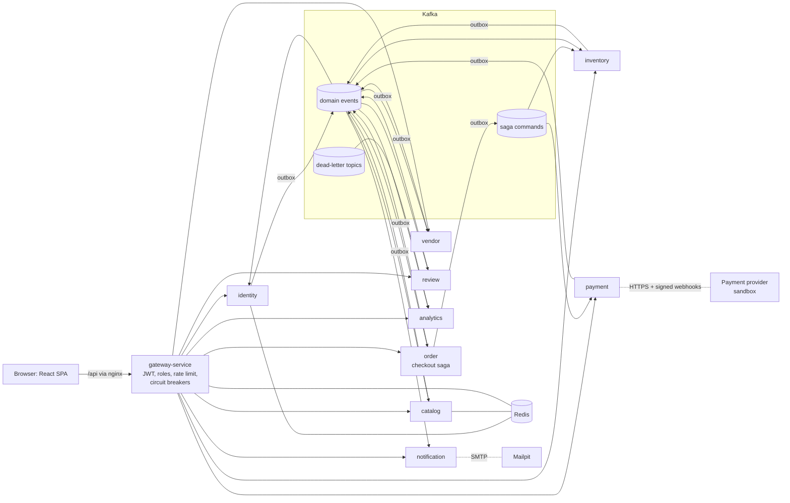
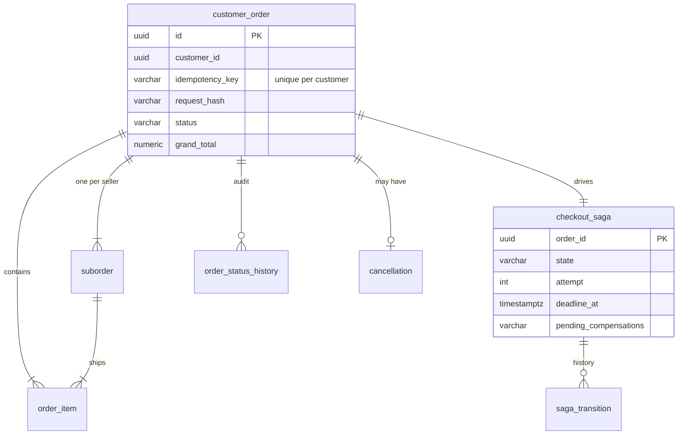
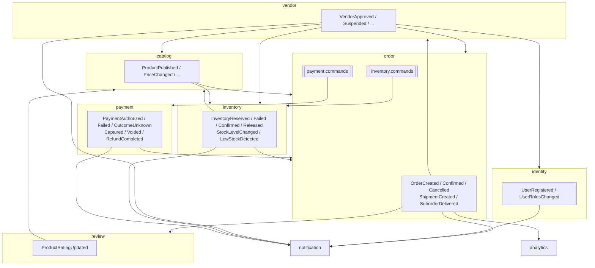
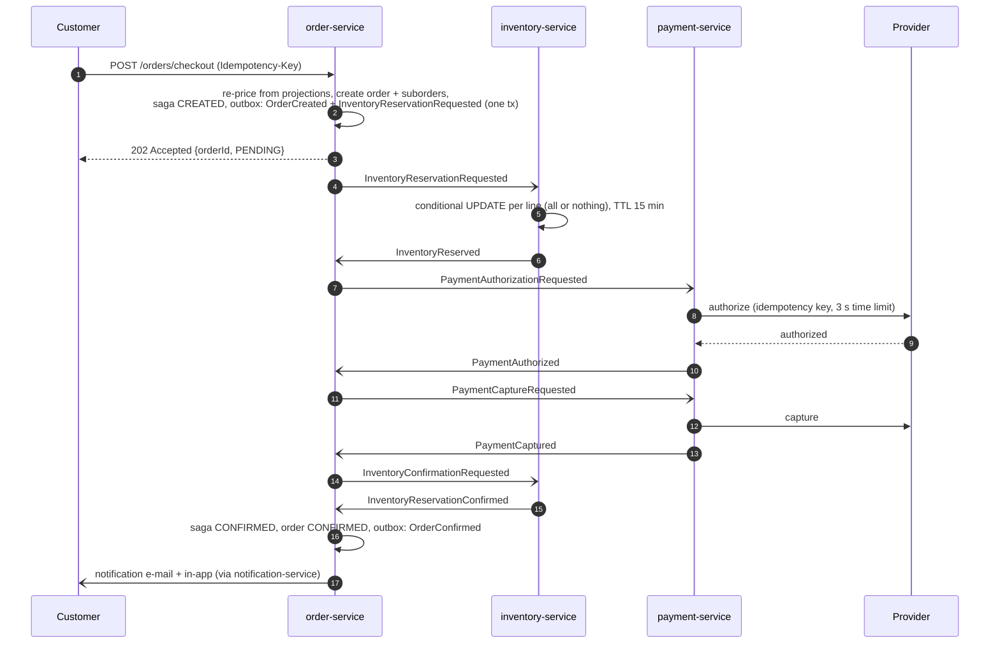

# MarketFlow

An event-driven, multi-vendor marketplace built as Java 21 / Spring Boot microservices with Kafka, PostgreSQL
and Redis, and a React storefront with seller and admin dashboards.

Independent sellers list products; customers buy from several sellers in one checkout; every seller ships
their own part of the order. The interesting part is underneath: checkout is a persisted, orchestrated saga
across order, inventory and payment services, every event goes through a transactional outbox, every consumer
is idempotent, stock cannot be oversold, and an unknown payment outcome is reconciled instead of guessed.

**Live demo: https://marketflow-demo.vercel.app** (the React storefront, seller hub and admin console with an
in-browser stand-in for the backend and sample data; use the banner to try it as a customer, seller or admin).
The demo does not run the Java services: see [Demo mode](#demo-mode) for what it is and is not.

> **Status.** Everything listed under Features is implemented and was exercised on 2026-10-11 against real
> PostgreSQL, Kafka and Redis: 136 backend tests (62 unit, 74 integration), 43 frontend unit tests, 7 Playwright
> browser tests and 12 API end-to-end checks passed, including on a clean install, plus k6 load tests with
> recorded results. The Docker images, Compose stack, Helm chart and GitHub workflows were validated statically
> but **not built, deployed or run** in that environment (no container registry access). Exactly what was verified,
> and how: [docs/implementation-status.md](docs/implementation-status.md).

## Contents

- [The problem and the approach](#the-problem-and-the-approach)
- [Features](#features)
- [Architecture](#architecture)
- [Checkout saga](#checkout-saga)
- [Failure and compensation scenarios](#failure-and-compensation-scenarios)
- [Security model](#security-model)
- [Technology](#technology)
- [Run it locally](#run-it-locally)
- [Demo accounts](#demo-accounts)
- [API](#api)
- [Tests](#tests)
- [Observability](#observability)
- [Kafka events and dead letters](#kafka-events-and-dead-letters)
- [Deployment](#deployment)
- [Troubleshooting](#troubleshooting)
- [Known limitations](#known-limitations)
- [Future improvements](#future-improvements)
- [Repository layout](#repository-layout)

## The problem and the approach

A marketplace checkout touches three things that must stay consistent and live in different services: the
order (split into one suborder per seller), the stock of every item, and the customer's money. No single
database transaction spans them, networks fail between any two steps, and Kafka delivers messages at least
once. The classic failure modes are charging a customer for an item that sold out, holding stock for a payment
that failed, oversold last units, duplicate orders from a double click, and orders silently stuck after a
crash.

MarketFlow addresses each one explicitly:

| Risk | Mechanism | Where |
|---|---|---|
| Event lost between DB commit and publish | Transactional outbox | [ADR 0003](docs/adr/0003-transactional-outbox.md) |
| Partial checkout across services | Orchestrated saga with compensations, persisted state | [ADR 0004](docs/adr/0004-orchestrated-checkout-saga.md) |
| Duplicate messages and retried requests | Consumer dedupe in the same transaction, idempotency keys | [ADR 0005](docs/adr/0005-idempotent-consumers.md) |
| Overselling the last unit | Conditional `UPDATE ... WHERE available >= n`, CHECK constraints, stock ledger | [ADR 0007](docs/adr/0007-preventing-overselling.md) |
| Payment timeout: charged or not? | `UNKNOWN` state, reconciliation, late void/refund | [ADR 0008](docs/adr/0008-payment-uncertainty-and-reconciliation.md) |
| Poison messages blocking consumers | Bounded retries, classified failures, DLT with replay tool | [runbook](docs/runbooks/dlt-replay.md) |

## Features

**Storefront and customers**
- Browse by category, full-text search (PostgreSQL `tsvector`) with price, rating and stock filters, product
  pages with variants, live availability, reviews and ratings.
- Cart across sellers, checkout with saved or new addresses, coupons (`WELCOME10`, `SPRING15`), sandbox cards
  that demonstrate approval, decline, capture failure, asynchronous confirmation and timeouts.
- Order tracking with live saga progress, per-seller shipments, cancellation with refund, in-app notifications
  and e-mail (Mailpit locally), reviews only for delivered purchases.
- Accounts: registration, sign-in with refresh-token rotation, password reset by e-mail, profile, addresses.

**Sellers**
- Apply to sell; admin approval grants the VENDOR role automatically (event-driven).
- Products with variants, prices, compare-at prices, images (upload or URL), publish/unpublish/archive.
- Inventory: adjustments with reasons, low-stock thresholds, movement history.
- Orders to fulfil (own suborders only), shipping with tracking, delivery; earnings ledger, commission, payouts;
  sales dashboard.

**Administrators**
- Marketplace overview (GMV, AOV, payment success, sales by seller, best sellers, low stock).
- Seller approval/rejection/suspension and commission; user activation; product moderation; categories.
- Orders with the full saga timeline, payments and refunds, review moderation, audit log.
- Operations: sagas by state, dead-lettered events across all services, undelivered notifications.

## Architecture



Each service has its own PostgreSQL database and login role; there are no cross-service joins or foreign
keys. Data another service needs is kept as a versioned projection fed by events.

| Service | Port | Responsibility | Database |
|---|---|---|---|
| gateway-service | 8080 (mgmt 8090) | Single entry point: JWT validation, role rules, CORS, security headers, rate limiting (Redis), circuit breakers, correlation ids | none |
| identity-service | 8081 | Users, BCrypt passwords, roles, RS256 JWT + JWKS, refresh-token rotation, password reset, addresses, login throttling | identity_db |
| vendor-service | 8082 | Seller applications and lifecycle, commission, earnings ledger from order events, payouts | vendor_db |
| catalog-service | 8083 | Categories, products, variants, images, storefront search, Redis cache-aside | catalog_db |
| inventory-service | 8084 | Stock counters, all-or-nothing reservations with TTL, confirmation, release, restock, movement ledger | inventory_db |
| order-service | 8085 | Pricing, orders and suborders, **checkout saga orchestrator**, cancellation, fulfilment | order_db |
| payment-service | 8086 | Authorise/capture/void/refund through a provider port, time limiter + breaker + bulkhead, webhooks, reconciliation | payment_db |
| notification-service | 8087 | E-mail and in-app notifications from domain events, retry topics, DLT | notification_db |
| review-service | 8088 | Verified-purchase reviews, moderation, rating aggregates | review_db |
| analytics-service | 8089 | Dashboard read models, audit log, dead-letter register | analytics_db |

Data model: [docs/architecture/data-model.md](docs/architecture/data-model.md) (ER diagram per service,
generated from the migrations). The core of order-service:



### Event flow



All 56 event types, their schemas, producers, consumers, keys and compatibility rules:
[contracts/events](contracts/events/README.md).

## Checkout saga



States: `CREATED, INVENTORY_PENDING, INVENTORY_RESERVED, PAYMENT_PENDING, PAYMENT_AUTHORIZED,
INVENTORY_CONFIRM_PENDING, CONFIRMED, COMPENSATING, CANCELLED, FAILED, RECONCILIATION_REQUIRED`. Each step has
a deadline; the timeout scanner re-sends the (idempotent) command a bounded number of times, then compensates.
Saga state and every transition are stored in order_db, so a restart continues where it stopped.

## Failure and compensation scenarios

| Scenario | What happens | Test |
|---|---|---|
| Item sold out | `InventoryReservationFailed`; nothing reserved, payment never touched; order CANCELLED (`OUT_OF_STOCK`) | `failedInventoryReservationCancelsWithoutTouchingPayment` |
| Card declined | `PaymentFailed`; compensation releases the reservation; CANCELLED (`PAYMENT_DECLINED`) | `declinedPaymentReleasesInventoryThenCancels` |
| Capture fails after authorisation | void authorisation + release stock, then CANCELLED (`CAPTURE_FAILED`) | `captureFailureVoidsAuthorisationAndReleasesStockBeforeCancelling` |
| Reservation expired while paying and stock gone | refund the capture, CANCELLED (`STOCK_UNAVAILABLE_AFTER_PAYMENT`) | `stockLostAfterPaymentTriggersRefund` |
| Provider timeout | `PaymentOutcomeUnknown`; saga waits in `RECONCILIATION_REQUIRED`; reconciliation settles it | `unknownPaymentOutcomeWaitsForReconciliationInsteadOfCancelling`, `lostProviderResponseIsReconciledInsteadOfAssumedFailed` |
| Reply never arrives / service crashed | deadline passes, command re-sent; after max attempts compensate; a late reply cannot leak stock | `persistedSagaResumesFromTheDatabaseAfterATimeout` |
| Customer cancels a confirmed order | refund and restock, both tracked in `cancellation` | `cancellationAfterConfirmationRefundsAndRestocks` |
| Late authorisation/capture after the saga gave up | automatically voided / refunded | saga notes `LatePaymentAuthorized` / `LatePaymentCaptured` |
| Duplicate replies, duplicate commands | ignored (counted in `saga_ignored_replies_total`), state unchanged | `happyPathConfirmsOrderAndDuplicateRepliesDoNotRepeatCommands` |

## Security model

- **Authentication**: identity-service issues RS256 access tokens (15 min) and publishes JWKS; services and the
  gateway validate signature, issuer, audience and expiry. Refresh tokens (7 days) are random, stored as SHA-256
  hashes, delivered as an `HttpOnly`, `SameSite=Strict` cookie limited to `/api/v1/auth` (`Secure` behind HTTPS),
  rotated on each use, and reuse of an old token revokes the whole family. The SPA keeps the access token in
  memory only.
- **Passwords**: BCrypt (cost 12), length and composition policy, account lock after 5 failed sign-ins for
  15 minutes, per-IP login throttling in Redis, password reset tokens single-use and hashed, password change
  revokes all sessions. Sign-in failures and password-reset requests do not reveal whether an e-mail is
  registered (registration itself does answer 409 for a taken address).
- **Authorisation, twice**: the gateway enforces route roles (`/api/v1/admin/**` ADMIN, `/api/v1/vendor/**`
  VENDOR); every service enforces `@PreAuthorize` plus ownership (a customer's orders, a vendor's products,
  suborders and earnings). Deny by default. Registration can never self-assign roles.
- **CSRF**: no cookies are used for API authentication; the refresh endpoint additionally requires the
  `X-Requested-With` header and SameSite=Strict.
- **Input and transport**: Bean Validation on every request, RFC 9457 problem responses without stack traces,
  request size limits, image uploads checked by magic bytes, security headers (CSP, HSTS behind TLS,
  X-Frame-Options, nosniff), CORS allow-list, rate limiting per user or IP.
- **Webhooks**: HMAC-SHA256 signature over timestamp and body, 5-minute tolerance, constant-time comparison,
  provider event ids stored to reject replays.
- **Secrets**: none in the repository. Compose refuses to start without `.env`; Helm references Kubernetes
  secrets created out of band. Databases use one least-privilege role per service.
- **Data in logs, metrics and events**: no passwords, tokens or card data; e-mail domains only in mail logs;
  dead-letter register stores exception class names, not messages; metric labels never contain user data.
- **Audit**: security and administrative actions (`auth.*`, `vendor.*`, `review.hidden`, refunds, ...) are
  published to `platform.audit.events` and searchable in Admin > Audit log.

## Technology

| Area | Choice |
|---|---|
| Backend | Java 21, Spring Boot 3.5, Spring Security (resource server), Spring Data JPA + JdbcTemplate, Flyway, Spring Kafka, Spring Cloud Gateway 2025.0 (WebFlux), Resilience4j, springdoc-openapi |
| Data | PostgreSQL 16 (one database per service), Redis 7 (rate limiting, login throttling, catalog cache) |
| Messaging | Apache Kafka 3.9, KRaft mode, JSON envelope with versioned schemas |
| Frontend | React 18, TypeScript, Vite, Tailwind CSS, TanStack Query, React Hook Form + Zod, Recharts, Lucide |
| Testing | JUnit 5, AssertJ, Spring Boot Test, Testcontainers (PostgreSQL, Redis), embedded Kafka, Vitest + Testing Library, Playwright, k6 |
| Observability | Micrometer + Prometheus, Grafana dashboards, OpenTelemetry tracing (OTLP) to Jaeger, structured JSON logs (Logstash format) with correlation ids |
| Delivery | Docker (multi-stage, layered jars, non-root), Docker Compose, Helm chart for Kubernetes, GitHub Actions |

## Demo mode

`VITE_DEMO_MODE=true npm run build` (in `frontend/`) builds the public demo deployed on Vercel
(`frontend/vercel.json`). It bundles `src/demo/`, a `fetch` interceptor that answers every `/api/*` call inside
the browser from sample data saved in the visitor's localStorage. It follows the real services' rules where the UI
depends on them: server-side pricing with coupons, shipping and tax; one suborder per seller; the checkout saga with
every sandbox card outcome (approved, asynchronous, timeout and reconciliation, declined, capture failure) and its
compensations; stock reservations; cancellation with refund and restock; verified-purchase reviews; seller
earnings; admin moderation, analytics and audit log. There is no Kafka, database or second user behind it, so it
demonstrates the product and the frontend, not the distributed backend. The regular build contains none of this
code (dynamic import). Playwright covers it: `E2E_DEMO=1 E2E_BASE_URL=http://localhost:4173 npx playwright test`
against `vite preview` of a demo build.

## Run it locally

Prerequisites: Docker with Compose v2 and at least 8 GB of memory for Docker; Node.js 20+ for the seed and
test scripts. Java 21 and Maven are only needed to build or test outside Docker.

```bash
make env                      # creates .env with random secrets (or: cp .env.example .env and edit)
docker compose up --build -d  # first build takes several minutes
docker compose ps             # wait until every service is healthy
node scripts/seed-demo.mjs    # demo sellers, products, stock and customers (reads the admin login from .env)
```

| URL | What |
|---|---|
| http://localhost:3000 | Storefront, seller hub (`/vendor`), admin (`/admin`) |
| http://localhost:8080 | API gateway |
| http://localhost:3001 | Grafana (admin / `GRAFANA_ADMIN_PASSWORD` from `.env`) |
| http://localhost:9090 | Prometheus |
| http://localhost:16686 | Jaeger (traces) |
| http://localhost:8025 | Mailpit (all e-mails) |
| http://localhost:808x/swagger-ui.html | Swagger UI of each service (ports in the table above) |

Stop with `docker compose down` (data kept) or `docker compose down -v` (deletes databases, Kafka history and
Grafana state; use it to start from scratch or after changing database passwords).

**Low-resource machines** (Docker with 2 CPUs / 4 GB, e.g. WSL 2 defaults on a laptop): give Docker more if you
can (Docker Desktop → Settings → Resources, or `%UserProfile%\.wslconfig` with WSL 2). Otherwise add these to `.env`
and start without the monitoring tools; the JVMs then skip the optimising compiler, which makes start-up much
lighter at the cost of peak throughput (do not use these settings for load tests):

```bash
MF_JAVA_OPTS=-XX:TieredStopAtLevel=1 -XX:+UseSerialGC -XX:MaxRAMPercentage=60 -Xss512k -XX:+ExitOnOutOfMemoryError
TRACING_ENABLED=false
```

```bash
docker compose down
docker compose up -d postgres kafka redis mailpit   # infrastructure first
docker compose up -d                                 # then everything else
docker compose stop jaeger prometheus grafana        # optional: frees a little more memory
```

If 3000 is taken on your machine, set `FRONTEND_HOST_PORT` in `.env` and open that port instead.

**A temporary public link** (free; works while your machine and the stack are running): install
[cloudflared](https://developers.cloudflare.com/cloudflare-one/connections/connect-networks/downloads/) and run
`cloudflared tunnel --url http://localhost:3000` (or your `FRONTEND_HOST_PORT`). It prints an
`https://<random>.trycloudflare.com` address that anyone can open. The storefront's nginx accepts API calls from
whatever host the page was opened on and still rejects cross-site requests, so no gateway change is needed.
Anyone with the link reaches your local stack: share it only for demos and stop the tunnel afterwards.

**Without Docker** (how the project was verified): run PostgreSQL 16, Kafka 3.9 and Redis 7 locally, create the
databases with `infrastructure/postgres/init/01-create-service-databases.sh`, `mvn -DskipTests package`, start
each `services/*/target/*.jar` with the environment variables from `docker-compose.yml`, and run the frontend
with `cd frontend && npm ci && npm run dev` (proxies `/api` to localhost:8080).

## Demo accounts

Created by `scripts/seed-demo.mjs`. **Development only**: these passwords are public.

| Role | E-mail | Password |
|---|---|---|
| Admin | `BOOTSTRAP_ADMIN_EMAIL` from `.env` (default admin@marketflow.local) | `BOOTSTRAP_ADMIN_PASSWORD` from `.env` |
| Seller | aurora@demo.marketflow.local (Aurora Sound Co.) | DemoPass2026! |
| Seller | northwind@demo.marketflow.local (Northwind Outfitters) | DemoPass2026! |
| Seller | kitchenco@demo.marketflow.local (Kitchen & Co) | DemoPass2026! |
| Customer | ada@demo.marketflow.local | DemoPass2026! |
| Customer | linus@demo.marketflow.local | DemoPass2026! |

Sandbox cards at checkout: Visa 4242 approves; 0002 declines; "fails at capture" authorises then fails;
"bank confirmation" approves later via signed webhook; "slow network" times out and is reconciled. The
"Aurora Limited Edition Turntable" has one unit, for trying two customers buying it at once.

## API

OpenAPI 3 specifications exported from the running services are in [contracts/api](contracts/api); each
service also serves Swagger UI. Every error is an RFC 9457 problem document with a `code` and the
`correlationId` (also returned as `X-Correlation-Id`).

```bash
# sign in (the refresh token arrives as an HttpOnly cookie)
curl -s -c jar -X POST localhost:8080/api/v1/auth/login -H 'Content-Type: application/json' \
  -d '{"email":"ada@demo.marketflow.local","password":"DemoPass2026!"}'
# -> {"accessToken":"eyJ...","tokenType":"Bearer","expiresIn":900,"user":{"id":"...","roles":["CUSTOMER"],...}}

TOKEN=...   # accessToken from above
curl -s 'localhost:8080/api/v1/products?q=headphones&inStock=true&sort=price_asc'

curl -s -X POST localhost:8080/api/v1/orders/checkout -H "Authorization: Bearer $TOKEN" \
  -H 'Content-Type: application/json' -H 'Idempotency-Key: 6f1c2a3e-checkout-1' \
  -d '{"items":[{"variantId":"<variant id>","quantity":1}],
       "shippingAddress":{"recipient":"Ada Moreno","line1":"1 Main St","city":"Portland","postalCode":"97201","country":"US"},
       "paymentToken":"tok_visa","couponCode":"WELCOME10"}'
# -> 202 {"id":"<order id>","status":"PENDING",...}; repeating the same request returns the same order

curl -s localhost:8080/api/v1/orders/<order id> -H "Authorization: Bearer $TOKEN"   # poll until CONFIRMED
```

Main route groups: `/api/v1/auth`, `/users/me`, `/products`, `/categories`, `/vendors`, `/orders`,
`/payments`, `/notifications`, `/products/{id}/reviews`; seller routes under `/api/v1/vendor/**`; admin routes
under `/api/v1/admin/**`.

## Tests

```bash
mvn test                      # backend unit tests (no Docker)
mvn verify                    # unit + integration tests; Testcontainers starts PostgreSQL and Redis, Kafka is embedded
cd frontend && npm test       # Vitest + Testing Library
cd frontend && npx playwright test        # browser tests against a running, seeded stack (E2E_ADMIN_PASSWORD optional)
node scripts/e2e-checkout.mjs             # API end-to-end checks against a running, seeded stack
python3 scripts/validate-contracts.py     # event examples against the JSON schemas
```

To reuse running databases instead of Testcontainers: `MF_TEST_DB_URL=jdbc:postgresql://localhost:5432/
MF_TEST_REDIS_HOST=localhost mvn verify` (each test context creates a fresh database).

The 18 mandatory scenarios and the tests that cover them:

| # | Scenario | Test |
|---|---|---|
| 1 | Unauthenticated access to protected APIs is rejected | `GatewaySecurityTest.protectedRouteWithoutTokenIs401ProblemJson`, `IdentityApiIT.protectedEndpointsRequireAuthentication`, `VendorApiIT.applicationRequiresAuthentication` |
| 2 | A customer cannot read another customer's order | `CheckoutSagaIT.customersCannotReadEachOthersOrders` |
| 3 | A vendor cannot modify another vendor's product | `CatalogApiIT.vendorCannotReadOrModifyAnotherVendorsProduct` |
| 4 | An unapproved vendor cannot publish | `CatalogApiIT.unapprovedVendorCannotCreateOrPublishProducts`, `ProductTest.unapprovedVendorCannotPublish`, `VendorApiIT.pendingVendorCannotUseVendorPortalEvenWithVendorRoleClaim` |
| 5 | Invalid quantities and prices are rejected | `CatalogApiIT.invalidPricesAndQuantitiesAreRejected`, `CheckoutSagaIT.invalidRequestsAreRejected`, `ProductTest.rejectsInvalidPrices` |
| 6 | Concurrent checkouts cannot oversell the last item | `InventoryIT.concurrentCheckoutsCannotOversellTheLastUnit` (20 threads, 1 unit) |
| 7 | Same idempotency key does not duplicate an order | `CheckoutSagaIT.sameIdempotencyKeyNeverCreatesASecondOrder`, `concurrentRequestsWithTheSameKeyCreateOneOrder` |
| 8 | Duplicate payment events do not double-capture | `PaymentIT.concurrentDuplicateCapturesCaptureOnce`, `authorizationCommandOverKafkaIsIdempotent` |
| 9 | Duplicate inventory events do not double reserve/release | `InventoryIT.repeatedAndConcurrentDuplicateReserveCommandsReserveOnce`, `duplicateReleaseDoesNotReleaseTwice` |
| 10 | Failed reservation triggers cancellation | `CheckoutSagaIT.failedInventoryReservationCancelsWithoutTouchingPayment` |
| 11 | Declined payment triggers compensation | `CheckoutSagaIT.declinedPaymentReleasesInventoryThenCancels` |
| 12 | A restart does not lose saga progress | `CheckoutSagaIT.persistedSagaResumesFromTheDatabaseAfterATimeout`; also verified live by SIGKILL of order-service |
| 13 | A duplicate webhook does not repeat the operation | `PaymentIT.asyncAuthorisationCompletesOnlyThroughASignedWebhookAndReplaysAreIgnored` |
| 14 | An invalid webhook signature is rejected | `WebhookSignatureTest` (5 cases); `PaymentIT` posts forged and unsigned webhooks and gets `400 invalid_signature` |
| 15 | An exhausted message goes to the DLT | `IdentityApiIT.malformedEventGoesToDeadLetterTopic`, `NotificationIT.permanentFailureGoesStraightToDeadLetterTopic` |
| 16 | Multi-vendor checkout creates parent order and suborders | `CheckoutSagaIT.multiVendorCheckoutCreatesParentOrderAndOneSuborderPerVendorWithServerPrices`, `PricingCalculatorTest` |
| 17 | A vendor sees only their own orders and earnings | `CheckoutSagaIT.vendorSeesAndShipsOnlyItsOwnSuborders`, `VendorApiIT.earningsLedgerIsBuiltOnceFromOrderEventsAndIsolatedPerVendor` |
| 18 | No reviews without a purchase | `ReviewIT.customerWhoNeverBoughtTheProductCannotReviewIt`, `cancelledPurchaseIsNotEligible` |

## Observability

- **Metrics**: every service exposes `/actuator/prometheus` (the gateway on its management port 8090).
  Business metrics include `checkout_requests_total{outcome}`, `saga_instances{state}`, `saga_duration_seconds`,
  `saga_compensations_total{reason}`, `saga_failures_total{step}`, `saga_timeouts_total`,
  `inventory_reservations_total{outcome}`, `payment_outcomes_total{operation,result}`,
  `payment_provider_calls_seconds`, `outbox_pending`, `outbox_failed`, `kafka_dlt_published_total`,
  `notifications_delivered_total{template}` plus Kafka consumer lag and HTTP latency histograms.
- **Dashboards** (Grafana, folder MarketFlow): Service health, Checkout saga, Kafka and outbox, Business
  operations. Generated by `infrastructure/grafana/generate_dashboards.py`.
- **Alerts**: `infrastructure/prometheus/alerts.yml` (service down, 5xx ratio, outbox backlog/parked events,
  dead letters, consumer lag, sagas needing reconciliation), each pointing at a runbook.
- **Tracing**: OpenTelemetry via Micrometer Tracing, exported over OTLP to Jaeger; trace context propagates
  through HTTP and Kafka headers. Correlation ids travel in `X-Correlation-Id` and in every event envelope.
- **Logs**: JSON (Logstash layout) in containers, `LOG_FORMAT=` for plain text locally.

Example queries:

```promql
histogram_quantile(0.95, sum by (le) (rate(saga_duration_seconds_bucket{outcome="CONFIRMED"}[5m])))
sum by (reason) (increase(saga_compensations_total[1h]))
sum(rate(payment_outcomes_total{operation="authorize",result="authorized"}[15m])) / sum(rate(payment_outcomes_total{operation="authorize"}[15m]))
max by (application, client_id) (kafka_consumer_fetch_manager_records_lag_max)
```

## Kafka events and dead letters

```bash
docker compose exec kafka /opt/kafka/bin/kafka-topics.sh --bootstrap-server localhost:9092 --list
docker compose exec kafka /opt/kafka/bin/kafka-console-consumer.sh --bootstrap-server localhost:9092 \
  --topic order.events --from-beginning --property print.key=true
cd scripts && npm ci && node dlt-replay.mjs list order.events.dlt      # inspect dead letters
node dlt-replay.mjs replay order.events.dlt --offset 3 --execute        # replay after fixing the cause
```

Dead letters also appear in Admin > Operations. Procedure: [docs/runbooks/dlt-replay.md](docs/runbooks/dlt-replay.md).

## Deployment

- **Kubernetes**: Helm chart in [infrastructure/helm/marketflow](infrastructure/helm/marketflow) with
  `values-dev.yaml` and `values-prod.yaml`: Deployments with startup/liveness/readiness probes, resources,
  HPAs, PDBs, Services, Ingress, ConfigMap, secret references, NetworkPolicy, PVC, optional ServiceMonitors.
  Steps in [infrastructure/kubernetes/README.md](infrastructure/kubernetes/README.md). PostgreSQL, Kafka and
  Redis are expected as managed services or separate charts.
- **CI** ([.github/workflows/ci.yml](.github/workflows/ci.yml)): backend unit and integration tests, frontend
  lint/typecheck/tests/build, Helm lint + kubeconform, Compose validation, event contract checks, dependency
  review, npm audit, Trivy, hadolint, CodeQL, then Docker images for every service. Images are pushed to GHCR
  only from `main`, after all checks pass, and only when the repository variable `PUBLISH_IMAGES=true` is set.
  [e2e.yml](.github/workflows/e2e.yml) runs the full Compose stack nightly with the API and browser suites.
- **A cloud deployment** has not been performed. A path for, e.g., AWS: EKS with the chart, RDS PostgreSQL
  (one database per service), MSK or Confluent Cloud, ElastiCache, secrets from AWS Secrets Manager via External
  Secrets, ingress-nginx or the AWS Load Balancer Controller with ACM certificates, and S3 for product images
  behind the `ImageStorage` interface.

## Troubleshooting

See [docs/runbooks/local-stack.md](docs/runbooks/local-stack.md) for startup problems and the other runbooks
for dead letters, payment reconciliation, outbox backlogs and stuck checkouts. Quick checks:
`docker compose ps`, `docker compose logs -f <service>`, Prometheus targets at http://localhost:9090/targets,
and the correlation id from any error response searched in logs or Jaeger.

## Known limitations

- The payment provider is a sandbox inside payment-service; no real PSP adapter exists yet.
- Single-currency (USD) pricing; tax is a flat rate and shipping a flat fee per seller.
- Search is PostgreSQL full-text (no prefix matching, no typo tolerance).
- Product images are stored on a local volume, which limits catalog to one writer node unless the volume is
  shared (ReadWriteMany) or object storage is added.
- Access tokens cannot be revoked before their 15-minute expiry.
- `processed_event` and the audit log are never pruned automatically.
- Kafka runs as a single node locally; replication, `min.insync.replicas` and rack awareness are configuration
  for production only.
- Docker images, the Compose stack and the Helm chart are validated but were not built or deployed in the
  verification environment.

## Future improvements

- Wake the outbox publisher on commit (or use CDC) instead of polling, to cut saga latency further.
- A real PSP adapter (Stripe/Adyen) behind the existing `PaymentProvider` port, with 3-D Secure.
- OpenSearch for catalog search; object storage for images.
- Schema registry with compatibility checks at publish time.
- Contract tests between producers and consumers generated from `contracts/events`.
- Multi-currency, tax rules per region, seller-specific shipping.
- Mutual TLS between services; finer-grained Kubernetes network policies.

## Repository layout

```
frontend/                 React SPA (storefront, seller hub, admin) + nginx config + tests
services/<name>-service/  one Spring Boot app each: api, application, domain, persistence, messaging, Flyway migrations, tests, Dockerfile
libs/platform-core/       shared infrastructure: event envelope, outbox, inbox, Kafka error handling, security, problem details
libs/platform-test/       test support: Testcontainers initialisers, JWT helpers, Kafka test client
contracts/events/         event JSON schemas, topic catalogue, real examples
contracts/api/            OpenAPI specs exported from the services
infrastructure/           postgres init, prometheus, grafana, docker, helm, kubernetes
load-tests/               k6 scripts, plan and recorded results
scripts/                  seed data, API e2e checks, DLT replay, contract validation, env generation
docs/                     ADRs, runbooks, data model, interview guide, implementation status
```
