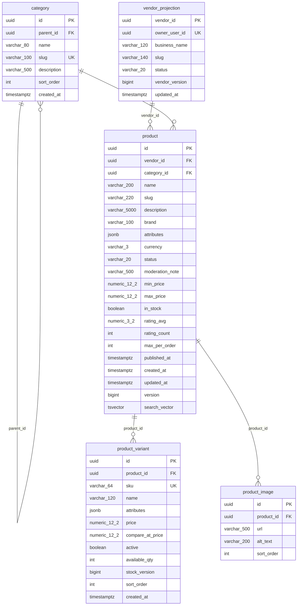
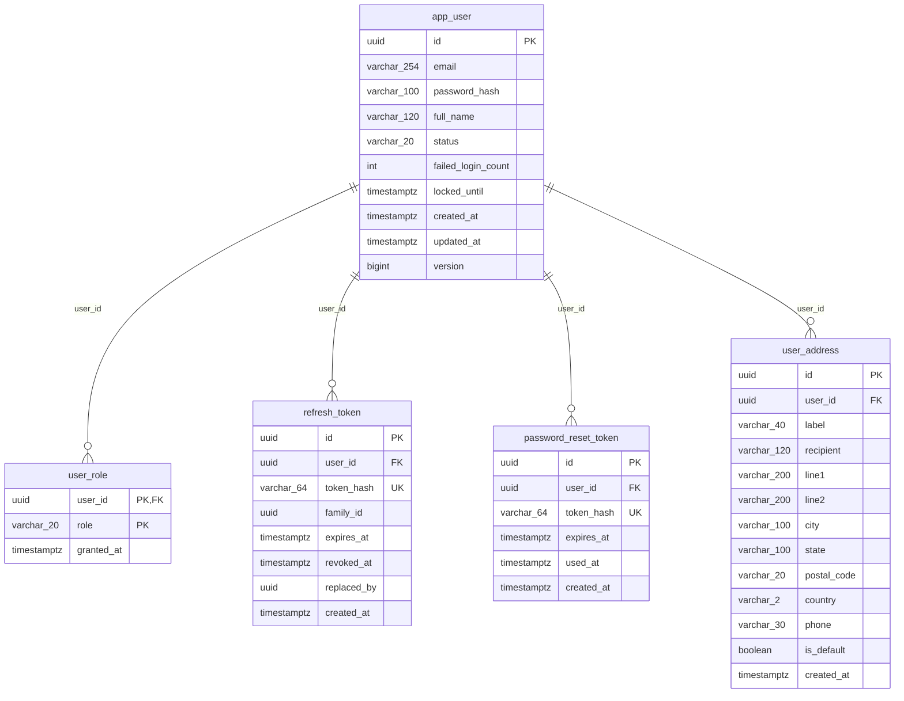
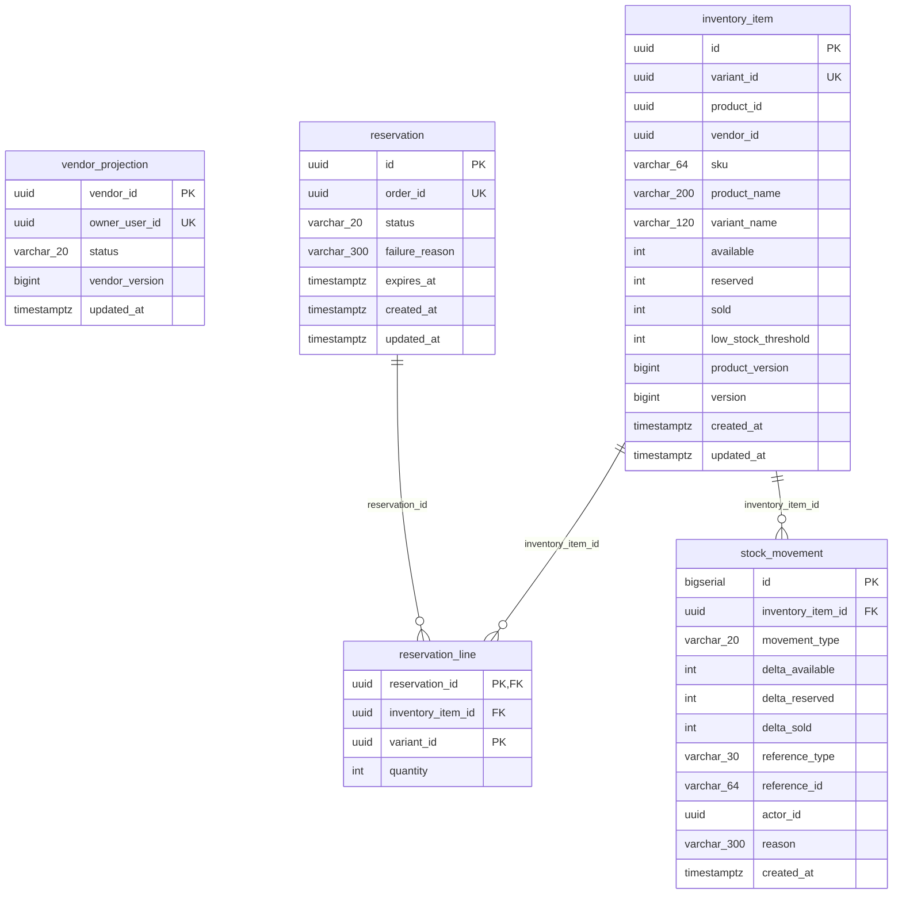
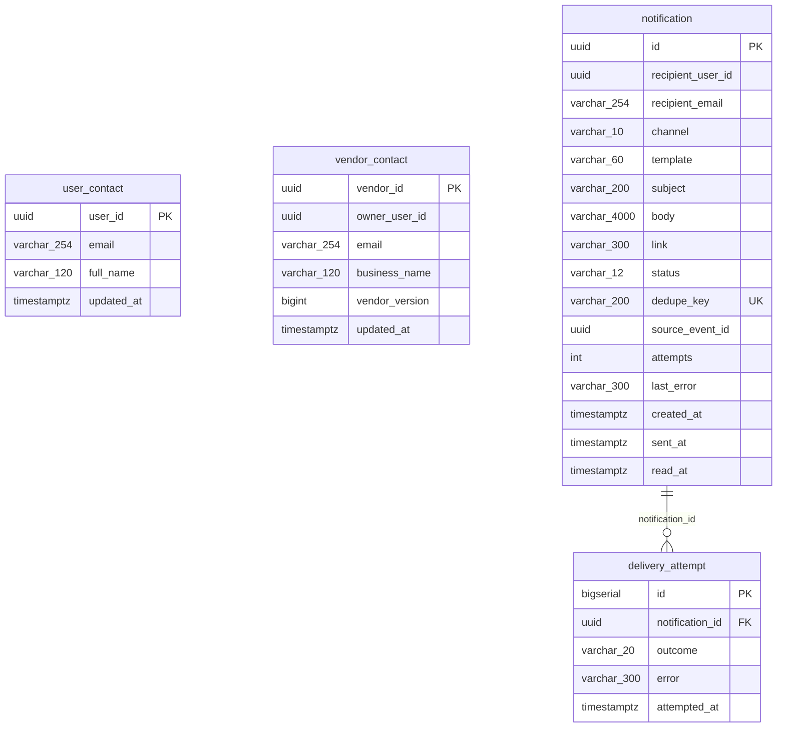
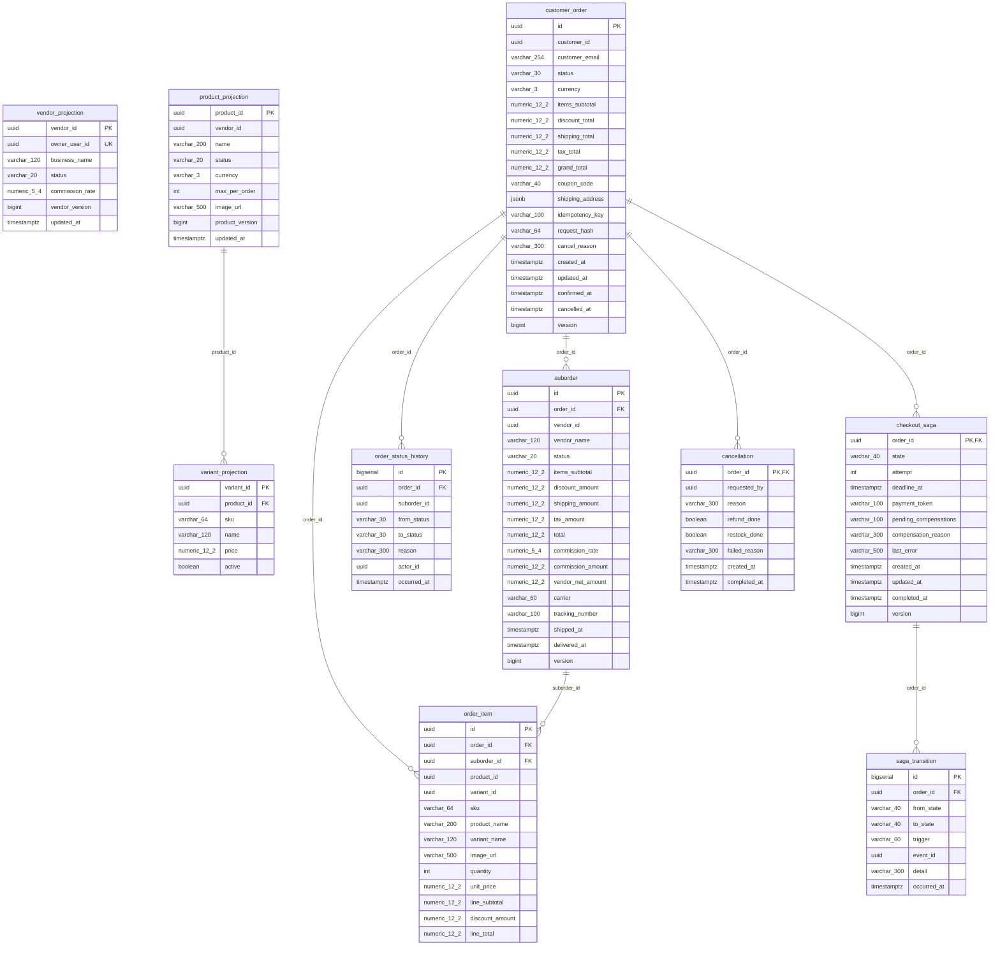
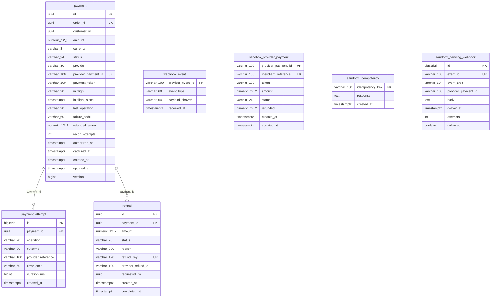
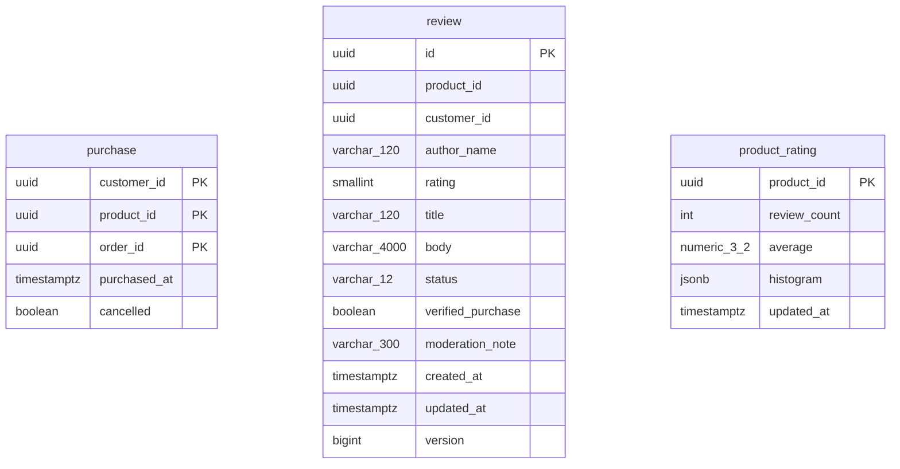
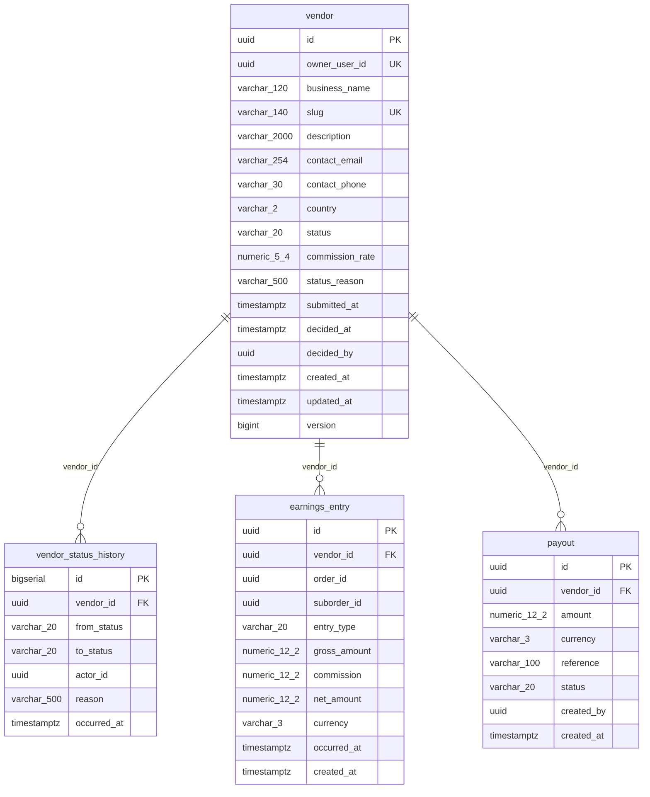

# Data model

Generated from the Flyway migrations by `docs/architecture/generate_er.py`. Each service owns its
database (ADR 0006); there are no foreign keys between services, only ids carried in events.

Every service also has the same two infrastructure tables:

- `outbox_event` (id, event_id, aggregate_type, aggregate_id, event_type, topic, msg_key, payload jsonb,
  status PENDING|PUBLISHED|FAILED, attempts, next_attempt_at, last_error, created_at, published_at):
  events written in the business transaction and published by `OutboxPublisher` (ADR 0003).
- `processed_event` (consumer, event_id, processed_at; primary key (consumer, event_id)): consumer
  deduplication written in the same transaction as the consumer's update (ADR 0005).

## analytics-service

```mermaid
erDiagram
    vendor_dim {
        uuid vendor_id PK
        uuid owner_user_id
        varchar_120 business_name
        varchar_20 status
        bigint vendor_version
    }
    order_fact {
        uuid order_id PK
        uuid customer_id
        varchar_30 status
        numeric_12_2 total
        varchar_3 currency
        int vendor_count
        int item_count
        varchar_100 cancel_reason
        timestamptz created_at
        timestamptz confirmed_at
        timestamptz cancelled_at
    }
    suborder_fact {
        uuid suborder_id PK
        uuid order_id
        uuid vendor_id
        varchar_120 vendor_name
        varchar_20 status
        numeric_12_2 total
        numeric_12_2 commission
        numeric_12_2 vendor_net
        timestamptz confirmed_at
    }
    item_fact {
        uuid suborder_id PK
        uuid variant_id PK
        uuid product_id
        uuid vendor_id
        varchar_200 product_name
        varchar_64 sku
        int quantity
        numeric_12_2 revenue
        timestamptz confirmed_at
        boolean cancelled
    }
    payment_fact {
        uuid order_id PK
        varchar_24 status
        numeric_12_2 amount
        numeric_12_2 refunded_amount
        varchar_60 failure_code
        timestamptz updated_at
    }
    inventory_alert {
        uuid variant_id PK
        uuid vendor_id
        uuid product_id
        varchar_64 sku
        varchar_200 product_name
        int available
        int threshold
        timestamptz detected_at
        timestamptz resolved_at
    }
    audit_log {
        uuid event_id PK
        varchar_60 service
        uuid actor_id
        varchar_20 actor_role
        varchar_80 action
        varchar_60 resource_type
        varchar_64 resource_id
        varchar_20 outcome
        jsonb details
        varchar_64 correlation_id
        timestamptz occurred_at
    }
    dead_letter {
        bigserial id PK
        varchar_200 topic
        int partition_no
        bigint offset_no
        varchar_100 consumer
        varchar_300 exception
        varchar_100 event_type
        varchar_64 event_id
        timestamptz received_at
    }
    consumer_checkpoint {
        varchar_60 stream PK
        timestamptz last_event_at
        bigint events_total
    }
```

## catalog-service

## identity-service

## inventory-service

## notification-service

## order-service

## payment-service

## review-service

## vendor-service

